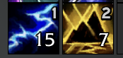
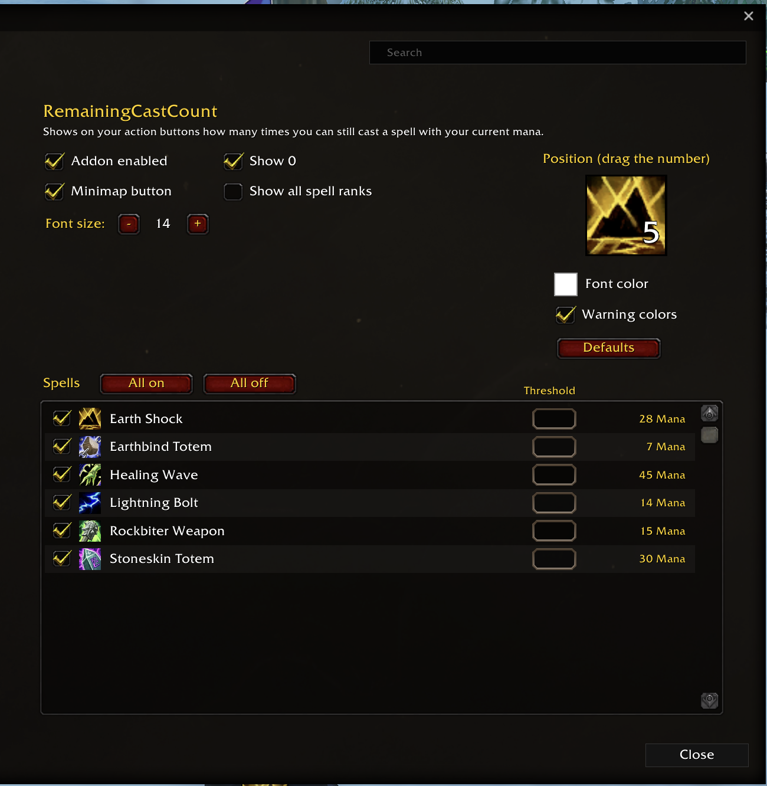

# RemainingCastCount

Shows on your action buttons how many times you can still cast each spell with your current mana. Requires WoW: Forever (interface 16001).

## Download

- [GitHub releases](https://github.com/alexbauerde/RemainingCastCount/releases)

## Features

- A number on every action button with a mana spell: how many casts your current mana still pays for.
- Warning colors: 0 in red, 1–2 in yellow (can be turned off).
- Works with the Blizzard action bars and with LibActionButton bars (Bartender, ElvUI and others).
- Turn the number off for single spells, or for single spell ranks.
- Threshold per spell: the number only shows once it is at or below the value you set.
- Font size and color, and drag the number to where it should sit on the button.
- Minimap button and addon compartment entry.
- English and German.

## Settings

## Usage

- `/rcc` opens the settings.
- `/rcc debug` prints what the addon sees on your buttons (helpful in bug reports).

## Why this addon

Back in WoW Season of Mastery I played a Frost Mage and used an addon that did exactly this: show how many casts my mana had left. I couldn't find it anymore, so with my background in software development (web and SAP development) I built it again for myself, together with Claude. My version goes further than the old one: you can style the number (size, color, position on the button), switch it on or off per spell, and set a threshold per spell so it only shows when it matters. I didn't want to keep it to myself, so here it is for anyone who also likes such infos.

## Bugs and ideas

[Open an issue](https://github.com/alexbauerde/RemainingCastCount/issues).
